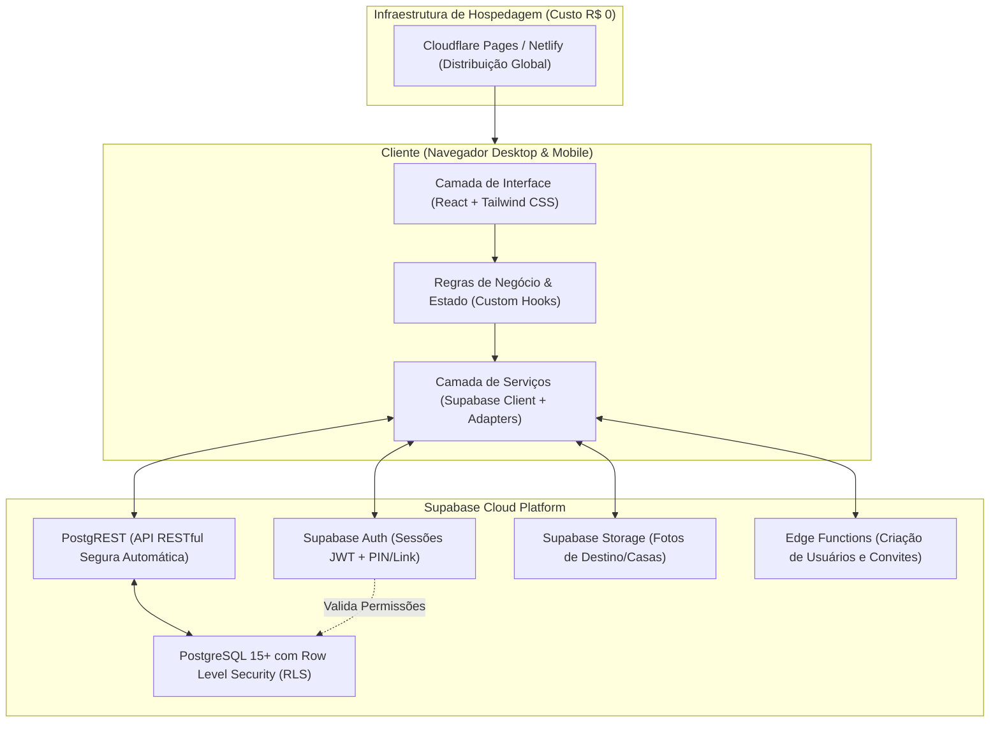

# 🏛️ Arquitetura do Sistema — Rota de Verão

> Este documento descreve as decisões de arquitetura de software, a organização do código, a pilha tecnológica e o fluxo de dados do projeto **Rota de Verão**.

---

## 1. Visão Geral da Arquitetura

O **Rota de Verão** adota uma arquitetura do tipo **BaaS (Backend-as-a-Service)** com uma **SPA (Single Page Application)** moderna, desacoplada e fortemente tipada. 

Essa escolha elimina a necessidade de gerenciar servidores virtuais (VPS), Docker ou rotinas manuais de manutenção de infraestrutura, garantindo **Custo R$ 0,00**, alta disponibilidade e foco total nas regras de negócio e na experiência do usuário.



---

## 2. Pilha Tecnológica e Justificativas Técnicas

### 2.1. Frontend: React 18+ com TypeScript e Vite

- **React**: Biblioteca padrão da indústria para criação de interfaces declarativas e baseadas em componentes reutilizáveis.
- **TypeScript**: Garante que erros de tipagem sejam capturados durante a digitação do código, e não na mão dos convidados da viagem.
- **Vite**: Ferramenta de build de última geração que inicializa o ambiente de desenvolvimento em milissegundos e gera bundles de produção otimizados.
- **Tailwind CSS**: Permite estilização atômica e responsiva com rapidez. Facilita a aplicação da paleta *Coastal Modern* de forma consistente por meio de variáveis e classes utilitárias.
- **Lucide React**: Pacote de ícones minimalistas, leves e legíveis, alinhados à identidade visual praiana e refinada.

### 2.2. Backend & Persistência: Supabase (PostgreSQL 15+)

- **PostgreSQL**: Banco de dados relacional robusto, com suporte a transações ACID, integridade referencial estrita e types customizados (ENUMs).
- **Row Level Security (RLS)**: O grande pilar de segurança. As regras de leitura e escrita são executadas pelo próprio PostgreSQL para cada linha da tabela com base no usuário autenticado (`auth.uid()`).
- **Supabase Auth**: Gerencia tokens de autenticação (JWT) e expiração de sessão com segurança de ponta.
- **Supabase Storage**: Armazena imagens de alta resolução do destino, das casas e dos carros de forma segura, com URLs públicas ou restritas.

### 2.3. Hospedagem: Cloudflare Pages Free (Recomendada) vs. Netlify Free

| Critério | Cloudflare Pages Free (Recomendada) | Netlify Free |
| :--- | :--- | :--- |
| **Custo Mensal** | **R$ 0,00** | **R$ 0,00** |
| **Largura de Banda** | **Ilimitada** | 100 GB / mês |
| **Builds por Mês** | 500 builds / mês | 300 minutos / mês |
| **Certificado SSL** | Automático e gratuito | Automático e gratuito |
| **Deploy com Git** | Integração contínua nativa com GitHub | Integração contínua nativa com GitHub |
| **Veredito** | **Vencedora**: a largura de banda ilimitada garante tranquilidade total com fotos de alta qualidade. | Alternativa sólida de reserva imediata. |

---

## 3. Estrutura de Diretórios Proposta

O código será organizado em camadas de responsabilidade bem delimitadas dentro de `src/`:

```
d:/VIAGEM/
├── .github/                     # Workflows de CI/CD (GitHub Actions)
├── docs/                        # Documentação técnica e arquitetural
│   ├── ARQUITETURA.md
│   ├── REQUISITOS.md
│   ├── MODELO_DE_DADOS.md
│   ├── REGRAS_DE_NEGOCIO.md
│   ├── SEGURANCA.md
│   └── PLANO_DE_IMPLEMENTACAO.md
├── public/                      # Ativos estáticos públicos (favicon, manifest)
│   └── images/                  # Imagens padrão de fallback
├── src/
│   ├── @types/                  # Extensões globais de tipos e declarações de ambiente
│   │   ├── database.types.ts    # Tipagem gerada automaticamente do PostgreSQL
│   │   └── index.ts
│   ├── assets/                  # Logos, ilustrações SVG e fontes locais
│   ├── components/              # Componentes reutilizáveis de interface
│   │   ├── common/              # Botões, Cards, Modais, Badges, Loaders, Toasts
│   │   ├── layout/              # Navbar, Sidebar de Admin, Rodapé, Contêiner
│   │   ├── dashboard/           # Cards de resumo, contadores, banner de destino
│   │   ├── couples/             # Visualização e agrupamento de casais
│   │   ├── flights/             # Cards de voos e comparativo de preços
│   │   ├── accommodations/      # Carrossel de fotos da casa, comodidades
│   │   ├── vehicles/            # Cards de carros e seletor de interessados
│   │   ├── expenses/            # Tabela de rateio, filtros e extrato individual
│   │   └── votes/               # Cards de votação, barra de progresso, opções
│   ├── constants/               # Constantes globais (cores do tema, rotas, chaves)
│   ├── contexts/                # React Contexts (Autenticação, Tema, Notificações)
│   │   └── AuthContext.tsx      # Gerenciamento de sessão, perfil e PIN
│   ├── hooks/                   # Custom Hooks (Regras de negócio e consumo de dados)
│   │   ├── useTrip.ts           # Dados da viagem corrente
│   │   ├── useCouples.ts        # Regras de agrupamento de casais
│   │   ├── useExpenses.ts       # Cálculos e rateio de despesas
│   │   └── useVotes.ts          # Votações e controle de prazos
│   ├── lib/                     # Configurações de clientes externos
│   │   ├── supabase.ts          # Inicialização tipada do cliente Supabase
│   │   └── dateUtils.ts         # Utilitários de formatação de datas (date-fns)
│   ├── pages/                   # Telas da aplicação (Roteadas)
│   │   ├── Login.tsx            # Tela de acesso simplificado via PIN / Convite
│   │   ├── Dashboard.tsx        # Visão geral da viagem (Participante e Admin)
│   │   ├── Participants.tsx     # Lista de presença e casais
│   │   ├── Accommodations.tsx   # Opções de hospedagem e votação
│   │   ├── Flights.tsx          # Opções de passagens cadastradas
│   │   ├── Vehicles.tsx         # Veículos e manifestação de interesse
│   │   ├── Expenses.tsx         # Extrato de despesas e divisões
│   │   ├── Votes.tsx            # Central de votações ativas e encerradas
│   │   └── admin/               # Área exclusiva da Administradora
│   │       ├── AdminDashboard.tsx
│   │       ├── ManageTrip.tsx
│   │       ├── ManageInvites.tsx
│   │       ├── ManageExpenses.tsx
│   │       └── AuditLogs.tsx
│   ├── routes/                  # Configuração de rotas e guardas de rota (ProtectedRoute)
│   │   ├── AppRoutes.tsx
│   │   └── ProtectedRoute.tsx
│   ├── services/                # Chamadas diretas à API do Supabase e integrações
│   │   ├── tripService.ts
│   │   ├── memberService.ts
│   │   ├── expenseService.ts
│   │   ├── voteService.ts
│   │   └── providers/           # Padrão Adapter para provedores de voos/veículos
│   │       ├── FlightProvider.ts
│   │       └── ManualFlightAdapter.ts
│   ├── styles/                  # Configuração de CSS e Tailwind
│   │   └── globals.css
│   ├── utils/                   # Funções utilitárias puras (moeda, máscaras, validações)
│   ├── App.tsx                  # Componente raiz
│   └── main.tsx                 # Ponto de entrada da aplicação
├── supabase/                    # Configurações locais do Supabase CLI
│   ├── functions/               # Supabase Edge Functions (Deno / TypeScript)
│   │   ├── verify-pin/          # Endpoint para validação segura de PIN e emissão de JWT
│   │   └── send-invite/         # Criação de link único de acesso
│   └── migrations/              # Arquivos SQL com controle de versão
│       └── 20261105000000_init_schema.sql
├── .env.example                 # Modelo de variáveis de ambiente
├── .gitignore                   # Arquivos ignorados pelo Git
├── index.html                   # HTML base com fontes e viewport mobile
├── package.json                 # Dependências e scripts do projeto
├── postcss.config.js            # Configuração do PostCSS
├── tailwind.config.js           # Extensão do tema Coastal Modern
├── tsconfig.json                # Configuração do compilador TypeScript
└── vite.config.ts               # Configuração do Vite
```

---

## 4. Camadas de Responsabilidade da Aplicação

Para manter o código sustentável, modular e fácil de entender, adotamos 4 camadas rígidas:

1. **Camada de Apresentação (`components/` e `pages/`)**:
   - Responsabilidade exclusiva de renderizar a interface visual.
   - Não executa chamadas SQL diretas e não calcula fórmulas complexas de rateio.
   - Apenas consome dados entregues pelos Hooks e dispara ações do usuário.

2. **Camada de Regras de Negócio e Estado (`hooks/` e `contexts/`)**:
   - Orquestra os fluxos: valida se o casal está pendente, se o prazo de votação expirou, qual o valor devido por participante em um carro.
   - Trata estados de carregamento (`isLoading`), sucesso e erro (`isError`).

3. **Camada de Acesso a Dados (`services/`)**:
   - Encapsula as chamadas ao Supabase (`supabase.from('...').select(...)`).
   - Se amanhã mudarmos uma tabela ou adicionarmos uma API externa, apenas essa camada é modificada, sem quebrar os componentes visuais.

4. **Camada de Domínio e Contratos (`@types/` e `utils/`)**:
   - Define os tipos das entidades do banco de dados e objetos de transferência.
   - Funções puras de formatação (ex: converter `1250.5` para `"R$ 1.250,50"`).

---

## 5. Padrão Adapter para Futuras Integrações de Preços

O requisito 7 solicita estudo de integração futura com companhias aéreas e locadoras (GOL, LATAM, Localiza), mantendo o sistema preparado sem acoplamento.

Implementamos o padrão de projeto **Adapter**:

```typescript
// Exemplo de contrato de provedor (Interface)
export interface FlightSearchProvider {
  searchFlights(params: FlightSearchParams): Promise<FlightOption[]>;
}

// Provedor Manual (Padrão do MVP)
export class ManualFlightAdapter implements FlightSearchProvider {
  async searchFlights(params: FlightSearchParams): Promise<FlightOption[]> {
    // Consulta os voos cadastrados manualmente pela administradora no banco
    return fetchDatabaseFlights(params);
  }
}

// Futuro Provedor com API Oficial (Quando homologada)
export class OfficialPartnerFlightAdapter implements FlightSearchProvider {
  async searchFlights(params: FlightSearchParams): Promise<FlightOption[]> {
    // Comunicação com API oficial externa
    return fetchPartnerFlights(params);
  }
}
```

Isso garante que a aplicação nunca precise ser reescrita quando uma nova fonte oficial de dados for homologada.

