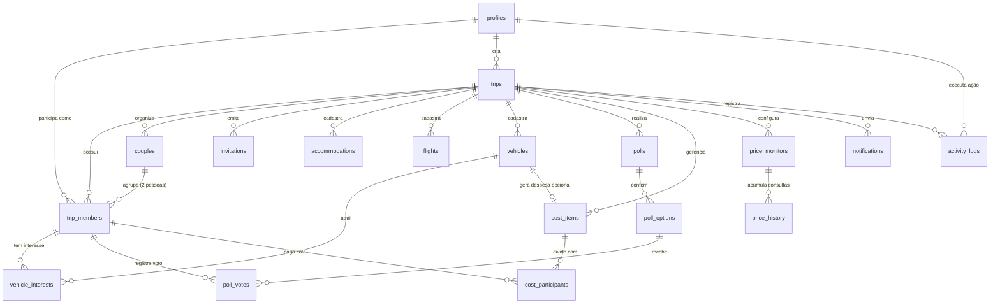

# 🗄️ Modelo de Dados — Rota de Verão

> Este documento descreve o modelo relacional de banco de dados (PostgreSQL no Supabase), diagramas de entidade-relacionamento (ER), tipos enumerados (ENUMs), tabelas, chaves primárias e estrangeiras e índices de performance.

---

## 1. Diagrama Entidade-Relacionamento (ER)



---

## 2. Tipos Enumerados (Custom ENUMs)

Para garantir integridade de dados e evitar erros de digitação:

```sql
-- Papel do participante na viagem
CREATE TYPE user_role AS ENUM ('admin', 'member');

-- Status de confirmação de presença do participante
CREATE TYPE confirmation_status AS ENUM ('pending', 'confirmed', 'declined');

-- Status de pagamento individual de uma cota
CREATE TYPE payment_status AS ENUM ('pending', 'paid', 'verified');

-- Categoria de despesas
CREATE TYPE expense_category AS ENUM (
    'flight',
    'accommodation',
    'vehicle',
    'food',
    'tour',
    'other'
);

-- Critério de rateio da despesa
CREATE TYPE split_criterion AS ENUM (
    'individual',              -- Custo atribuído a uma única pessoa
    'equal_all_confirmed',     -- Dividido igualmente entre todos confirmados
    'equal_custom',            -- Dividido entre participantes selecionados
    'vehicle_users'            -- Dividido estritamente entre interessados no carro
);

-- Categoria da votação
CREATE TYPE poll_category AS ENUM (
    'accommodation',
    'vehicle',
    'tour',
    'restaurant',
    'general'
);

-- Tipo de notificação interna
CREATE TYPE notification_type AS ENUM (
    'poll_created',
    'trip_updated',
    'price_alert',
    'expense_added',
    'system'
);
```

---

## 3. Especificação Detalhada das Tabelas

### 3.1. `profiles`
Contém informações públicas e de perfil do usuário, vinculado diretamente à tabela de autenticação `auth.users` do Supabase.

| Coluna | Tipo | Nulo? | Descrição |
| :--- | :--- | :--- | :--- |
| `id` | `UUID` | NÃO | Chave primária. Referência a `auth.users(id) ON DELETE CASCADE`. |
| `full_name` | `VARCHAR(100)` | NÃO | Nome completo do participante. |
| `nickname` | `VARCHAR(50)` | SIM | Apelido ou nome social para exibição amigável. |
| `phone` | `VARCHAR(20)` | SIM | Número para contato/WhatsApp. |
| `avatar_url` | `TEXT` | SIM | Link da foto de perfil. |
| `created_at` | `TIMESTAMPTZ` | NÃO | Data de criação do perfil. Default: `now()`. |
| `updated_at` | `TIMESTAMPTZ` | NÃO | Data de última atualização. Default: `now()`. |

### 3.2. `trips`
Armazena os detalhes da viagem.

| Coluna | Tipo | Nulo? | Descrição |
| :--- | :--- | :--- | :--- |
| `id` | `UUID` | NÃO | Chave primária (`gen_random_uuid()`). |
| `title` | `VARCHAR(120)` | NÃO | Nome da viagem (ex: "Rota de Verão 2027"). |
| `destination` | `VARCHAR(100)` | NÃO | Cidade e estado de destino (ex: "Fortaleza - CE"). |
| `start_date` | `DATE` | NÃO | Data prevista de início da viagem. |
| `end_date` | `DATE` | NÃO | Data prevista de término da viagem. |
| `cover_image_url` | `TEXT` | SIM | Imagem de capa do destino em alta definição. |
| `description` | `TEXT` | SIM | Resumo e notas gerais sobre a viagem. |
| `created_by` | `UUID` | NÃO | Chave estrangeira para `profiles(id)`. |
| `created_at` | `TIMESTAMPTZ` | NÃO | Data de cadastro. Default: `now()`. |
| `updated_at` | `TIMESTAMPTZ` | NÃO | Data de atualização. Default: `now()`. |

### 3.3. `couples`
Registra os agrupamentos de casais para exibição consolidada e acompanhamento conjunto.

| Coluna | Tipo | Nulo? | Descrição |
| :--- | :--- | :--- | :--- |
| `id` | `UUID` | NÃO | Chave primária (`gen_random_uuid()`). |
| `trip_id` | `UUID` | NÃO | Chave estrangeira para `trips(id) ON DELETE CASCADE`. |
| `label` | `VARCHAR(50)` | NÃO | Rótulo do casal (ex: "Casal 01 — Ana e Pedro"). |
| `member_a_id` | `UUID` | NÃO | Referência ao perfil da primeira pessoa (`profiles.id`). |
| `member_b_id` | `UUID` | NÃO | Referência ao perfil da segunda pessoa (`profiles.id`). |
| `created_at` | `TIMESTAMPTZ` | NÃO | Default: `now()`. |

*Restrições*: `CHECK (member_a_id <> member_b_id)`, `UNIQUE (trip_id, member_a_id)`, `UNIQUE (trip_id, member_b_id)`.

### 3.4. `trip_members`
Associa perfis à viagem com papel, status de confirmação e vínculo de casal.

| Coluna | Tipo | Nulo? | Descrição |
| :--- | :--- | :--- | :--- |
| `id` | `UUID` | NÃO | Chave primária (`gen_random_uuid()`). |
| `trip_id` | `UUID` | NÃO | Chave estrangeira para `trips(id) ON DELETE CASCADE`. |
| `profile_id` | `UUID` | NÃO | Chave estrangeira para `profiles(id) ON DELETE CASCADE`. |
| `role` | `user_role` | NÃO | Papel do membro: `'admin'` ou `'member'`. Default: `'member'`. |
| `confirmation_status` | `confirmation_status` | NÃO | `'pending'`, `'confirmed'` ou `'declined'`. Default: `'pending'`. |
| `couple_id` | `UUID` | SIM | Referência opcional a `couples(id) ON DELETE SET NULL`. |
| `confirmed_at` | `TIMESTAMPTZ` | SIM | Data e hora em que a presença foi confirmada/recusada. |
| `created_at` | `TIMESTAMPTZ` | NÃO | Default: `now()`. |

*Restrições*: `UNIQUE(trip_id, profile_id)`.

### 3.5. `invitations`
Controle de convites individuais com link criptografado e código PIN.

| Coluna | Tipo | Nulo? | Descrição |
| :--- | :--- | :--- | :--- |
| `id` | `UUID` | NÃO | Chave primária (`gen_random_uuid()`). |
| `trip_id` | `UUID` | NÃO | Referência a `trips(id) ON DELETE CASCADE`. |
| `profile_id` | `UUID` | NÃO | Referência a `profiles(id) ON DELETE CASCADE`. |
| `pin_hash` | `TEXT` | NÃO | Hash seguro do código PIN de 6 dígitos. |
| `token` | `TEXT` | NÃO | Token aleatório criptograficamente forte para link direto. |
| `expires_at` | `TIMESTAMPTZ` | NÃO | Validade do convite. |
| `is_revoked` | `BOOLEAN` | NÃO | Se foi cancelado pela Administradora. Default: `false`. |
| `last_used_at` | `TIMESTAMPTZ` | SIM | Data do último login por este convite. |
| `created_at` | `TIMESTAMPTZ` | NÃO | Default: `now()`. |

*Restrições*: `UNIQUE(token)`, `UNIQUE(trip_id, profile_id)`.

### 3.6. `accommodations`
Opções de hospedagem cadastradas pela Administradora.

| Coluna | Tipo | Nulo? | Descrição |
| :--- | :--- | :--- | :--- |
| `id` | `UUID` | NÃO | Chave primária. |
| `trip_id` | `UUID` | NÃO | Referência a `trips(id) ON DELETE CASCADE`. |
| `name` | `VARCHAR(150)` | NÃO | Nome ou título da acomodação (ex: "Casa da Praia Beira-Mar"). |
| `address` | `TEXT` | SIM | Endereço ou localização aproximada. |
| `photos` | `TEXT[]` | NÃO | Lista de URLs de fotos da casa. Default: `{}`. |
| `bedrooms_count` | `INTEGER` | NÃO | Quantidade de quartos disponíveis. |
| `total_capacity` | `INTEGER` | NÃO | Capacidade máxima de hóspedes. |
| `total_amount` | `NUMERIC(10,2)`| NÃO | Valor total da hospedagem para o período. |
| `external_url` | `TEXT` | SIM | Link no Airbnb, Booking ou contato direto. |
| `notes` | `TEXT` | SIM | Regras da casa, comodidades (ar-condicionado, piscina, etc.). |
| `created_at` | `TIMESTAMPTZ` | NÃO | Default: `now()`. |

### 3.7. `flights`
Opções de passagens aéreas pesquisadas ou sugeridas.

| Coluna | Tipo | Nulo? | Descrição |
| :--- | :--- | :--- | :--- |
| `id` | `UUID` | NÃO | Chave primária. |
| `trip_id` | `UUID` | NÃO | Referência a `trips(id) ON DELETE CASCADE`. |
| `airline` | `VARCHAR(80)` | NÃO | Companhia aérea (GOL, LATAM, Azul, etc.). |
| `origin_airport` | `VARCHAR(4)` | NÃO | Código IATA de origem (ex: "GRU", "CGH"). |
| `destination_airport` | `VARCHAR(4)` | NÃO | Código IATA de destino (ex: "FOR"). |
| `departure_time` | `TIMESTAMPTZ` | NÃO | Data e hora de partida. |
| `arrival_time` | `TIMESTAMPTZ` | NÃO | Data e hora de chegada estimada. |
| `flight_number` | `VARCHAR(20)` | SIM | Código do voo (ex: "G3 1502"). |
| `price` | `NUMERIC(10,2)`| NÃO | Preço da tarifa individual. |
| `baggage_included` | `BOOLEAN` | NÃO | Se inclui bagagem despachada. Default: `false`. |
| `purchase_url` | `TEXT` | SIM | Link para conferência ou compra externa. |
| `created_at` | `TIMESTAMPTZ` | NÃO | Default: `now()`. |

### 3.8. `vehicles`
Veículos disponíveis para locação e organização de translado.

| Coluna | Tipo | Nulo? | Descrição |
| :--- | :--- | :--- | :--- |
| `id` | `UUID` | NÃO | Chave primária. |
| `trip_id` | `UUID` | NÃO | Referência a `trips(id) ON DELETE CASCADE`. |
| `model` | `VARCHAR(100)` | NÃO | Modelo e marca (ex: "Jeep Renegade ou similar"). |
| `category` | `VARCHAR(50)` | NÃO | Categoria (ex: "SUV", "Compacto", "Minivan 7 lugares"). |
| `passenger_capacity` | `INTEGER` | NÃO | Número de assentos para passageiros. |
| `luggage_capacity` | `INTEGER` | NÃO | Capacidade aproximada de malas grandes. |
| `daily_rate` | `NUMERIC(10,2)`| NÃO | Valor unitário da diária. |
| `total_days` | `INTEGER` | NÃO | Quantidade total de diárias. |
| `total_amount` | `NUMERIC(10,2)`| NÃO | Custo total do aluguel (`daily_rate * total_days`). |
| `pickup_location` | `VARCHAR(100)` | NÃO | Local de retirada (ex: "Aeroporto de Fortaleza"). |
| `return_location` | `VARCHAR(100)` | NÃO | Local de devolução. |
| `rental_company` | `VARCHAR(80)` | SIM | Locadora (ex: "Localiza", "Movida"). |
| `external_url` | `TEXT` | SIM | Link para reserva externa. |
| `created_at` | `TIMESTAMPTZ` | NÃO | Default: `now()`. |

### 3.9. `vehicle_interests`
Registra quais participantes utilizarão cada veículo. Garante que os custos sejam atribuídos estritamente a quem usufruir.

| Coluna | Tipo | Nulo? | Descrição |
| :--- | :--- | :--- | :--- |
| `id` | `UUID` | NÃO | Chave primária. |
| `vehicle_id` | `UUID` | NÃO | Referência a `vehicles(id) ON DELETE CASCADE`. |
| `trip_member_id` | `UUID` | NÃO | Referência a `trip_members(id) ON DELETE CASCADE`. |
| `created_at` | `TIMESTAMPTZ` | NÃO | Default: `now()`. |

*Restrições*: `UNIQUE(vehicle_id, trip_member_id)`.

### 3.10. `polls` & `poll_options` & `poll_votes`
Módulo democrático de enquetes e decisões conjuntas.

**`polls`**:
- `id` (UUID PK), `trip_id` (FK trips), `title` (VARCHAR 150), `description` (TEXT), `category` (poll_category), `allows_change_vote` (BOOLEAN default true), `is_closed` (BOOLEAN default false), `deadline` (TIMESTAMPTZ), `created_at` (TIMESTAMPTZ).

**`poll_options`**:
- `id` (UUID PK), `poll_id` (FK polls), `title` (VARCHAR 150), `description` (TEXT), `image_url` (TEXT), `external_link` (TEXT), `accommodation_id` (FK accommodations opcional), `vehicle_id` (FK vehicles opcional), `created_at` (TIMESTAMPTZ).

**`poll_votes`**:
- `id` (UUID PK), `poll_id` (FK polls), `poll_option_id` (FK poll_options), `trip_member_id` (FK trip_members), `created_at` (TIMESTAMPTZ), `updated_at` (TIMESTAMPTZ).
- *Restrições*: `UNIQUE(poll_id, trip_member_id)`.

### 3.11. `cost_items` & `cost_participants`
Módulo financeiro de despesas, rateio transparente e controle de pagamento.

**`cost_items`**:
- `id` (UUID PK), `trip_id` (FK trips), `title` (VARCHAR 120), `category` (expense_category), `total_amount` (NUMERIC(10,2)), `split_criterion` (split_criterion), `vehicle_id` (FK vehicles opcional), `receipt_url` (TEXT), `notes` (TEXT), `created_by` (FK profiles), `created_at` (TIMESTAMPTZ).

**`cost_participants`**:
- `id` (UUID PK), `cost_item_id` (FK cost_items ON DELETE CASCADE), `trip_member_id` (FK trip_members ON DELETE CASCADE), `assigned_amount` (NUMERIC(10,2)), `payment_status` (payment_status default 'pending'), `paid_at` (TIMESTAMPTZ), `notes` (TEXT), `created_at` (TIMESTAMPTZ).
- *Restrições*: `UNIQUE(cost_item_id, trip_member_id)`.

### 3.12. `price_monitors` & `price_history`
Estrutura para alertas e acompanhamento de tarifas desejadas.

**`price_monitors`**:
- `id` (UUID PK), `trip_id` (FK trips), `target_type` (VARCHAR 20 - 'flight' ou 'vehicle'), `origin` (TEXT), `destination` (TEXT), `departure_date` (DATE), `return_date` (DATE), `target_price` (NUMERIC(10,2)), `is_active` (BOOLEAN default true), `created_at` (TIMESTAMPTZ).

**`price_history`**:
- `id` (UUID PK), `monitor_id` (FK price_monitors ON DELETE CASCADE), `price_found` (NUMERIC(10,2)), `source` (TEXT), `checked_at` (TIMESTAMPTZ default now()), `offer_url` (TEXT).

### 3.13. `activity_logs`
Trilha de auditoria imutável para segurança e transparência.

- `id` (UUID PK), `trip_id` (FK trips), `actor_id` (FK profiles), `action` (VARCHAR 50), `entity_name` (VARCHAR 50), `entity_id` (UUID), `details` (JSONB), `created_at` (TIMESTAMPTZ default now()).

---

## 4. Índices Estratégicos de Performance

Para garantir consultas instantâneas mesmo no tier gratuito:

```sql
CREATE INDEX idx_trip_members_trip_id ON trip_members(trip_id);
CREATE INDEX idx_trip_members_profile_id ON trip_members(profile_id);
CREATE INDEX idx_couples_trip_id ON couples(trip_id);
CREATE INDEX idx_invitations_token ON invitations(token);
CREATE INDEX idx_invitations_trip_profile ON invitations(trip_id, profile_id);
CREATE INDEX idx_poll_votes_poll_member ON poll_votes(poll_id, trip_member_id);
CREATE INDEX idx_cost_participants_member ON cost_participants(trip_member_id);
CREATE INDEX idx_cost_items_trip ON cost_items(trip_id);
CREATE INDEX idx_activity_logs_trip ON activity_logs(trip_id, created_at DESC);
```

