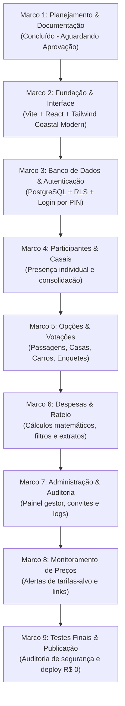

# 🗺️ Plano de Implementação e Testes — Rota de Verão

> Este documento estabelece o roteiro de execução sequencial do projeto **Rota de Verão**, detalhando os objetivos, entregáveis, critérios de aceitação e a estratégia de testes para cada marco.

---

## 1. Cronograma de Marcos (Milestones)



---

## 2. Detalhamento dos Marcos

### Marco 1 — Planejamento e Documentação (Etapa Atual)
- **Status**: 🏁 Concluído.
- **Entregáveis**:
  - `README.md`, `GEMINI.md`.
  - `docs/ARQUITETURA.md`, `docs/REQUISITOS.md`, `docs/MODELO_DE_DADOS.md`, `docs/REGRAS_DE_NEGOCIO.md`, `docs/SEGURANCA.md`, `docs/PLANO_DE_IMPLEMENTACAO.md`.
- **Validação**: Aprovação formal pela responsável pelo projeto.

---

### Marco 2 — Fundação e Interface (Próxima Etapa)
- **Objetivo**: Criar o esqueleto do projeto frontend com tipagem estrita e estilização baseada na paleta *Coastal Modern*.
- **Entregáveis**:
  - Setup do projeto com Vite, React, TypeScript e Tailwind CSS.
  - Configuração das cores do tema (`ocean`, `water`, `sand`, `offwhite`, `coral`).
  - Componentes base reutilizáveis: `Button`, `Card`, `Badge`, `Modal`, `Navbar`, `PageHeader`.
  - Páginas principais com dados mockados (Login, Dashboard, Participantes, Hospedagens, Voos, Carros, Despesas, Votações).
  - Roteamento configurado com React Router.
- **Como Testar**: Executar `npm run dev`, testar a navegação entre todas as telas no desktop e inspecionar a responsividade mobile no Chrome DevTools.

---

### Marco 3 — Banco de Dados e Autenticação
- **Objetivo**: Configurar o banco relacional no Supabase, criar tabelas, aplicar Row Level Security (RLS) e implementar o login sem atrito por PIN.
- **Entregáveis**:
  - Scripts SQL de migração executados no Supabase (`schema.sql` e `rls_policies.sql`).
  - Edge Function `verify-pin` para validação de PIN de 6 dígitos e emissão de sessão JWT.
  - `AuthContext` no React para manter o participante conectado no navegador.
  - Tela de login funcional e guardas de rota (`ProtectedRoute`).
- **Como Testar**: Entrar com um código PIN válido e verificar a emissão do token JWT no painel de armazenamento do navegador (`localStorage/cookie`); tentar acessar rotas protegidas sem autenticação e verificar o redirecionamento imediato.

---

### Marco 4 — Participantes e Casais
- **Objetivo**: Conectar a tela de participantes ao banco real, permitindo confirmação de presença individual e resumo de casais.
- **Entregáveis**:
  - `useTripMembers` e `useCouples` (Custom Hooks).
  - Botões para o participante marcar *Confirmado* ou *Recusado*.
  - Alternador de visualização: *Lista Individual* vs. *Visão por Casais*.
  - Indicadores visuais dos 4 estados de casal (*Confirmado*, *Parcialmente Confirmado*, *Pendente*, *Recusado*).
- **Como Testar**: Confirmar a presença de um integrante do casal e conferir que o parceiro permanece como pendente, mudando o status agregado do casal para *Parcialmente Confirmado*.

---

### Marco 5 — Opções e Votações
- **Objetivo**: Permitir o cadastro de opções de hospedagem, passagens e veículos, além de enquetes democráticas.
- **Entregáveis**:
  - Módulos visuais de Hospedagens (carrossel de fotos, endereço, capacidade, preço).
  - Módulo de Passagens com voos sugeridos e links de compra externa.
  - Módulo de Veículos com botão para o participante assinalar interesse.
  - Sistema de enquetes com votação única, barra de apuração percentual e controle de prazo.
- **Como Testar**: Votar em uma opção de hospedagem e tentar votar novamente para garantir que o banco impeça duplicidade; verificar atualização da porcentagem em tempo real.

---

### Marco 6 — Despesas e Rateio
- **Objetivo**: Implementar o motor financeiro com rateio transparente e extrato individual.
- **Entregáveis**:
  - Formulário para a Administradora cadastrar despesas e escolher o critério de divisão.
  - Lógica matemática de rateio (individual, igualitária entre confirmados, ou exclusiva entre interessados no veículo).
  - Tela de extrato individual onde cada participante vê apenas suas cotas e status de quitação.
- **Como Testar**: Cadastrar um carro de R$ 1.500 com 3 interessados e conferir se cada um recebe exatamente a cota de R$ 500, sem afetar os outros participantes não inscritos no carro.

---

### Marco 7 — Administração e Auditoria
- **Objetivo**: Concluir o painel administrativo da organizadora e o histórico de atividades.
- **Entregáveis**:
  - Área exclusiva `/admin` protegida por verificação de perfil no banco (`role = 'admin'`).
  - Gerenciador de convites (geração de links e PINs, revogação em um clique).
  - Feed de auditoria imutável (`activity_logs`) registrando eventos críticos da viagem.
- **Como Testar**: Tentar acessar a rota `/admin` logado como um participante comum e comprovar o bloqueio tanto visual quanto via RLS no banco de dados.

---

### Marco 8 — Monitoramento de Preços
- **Objetivo**: Disponibilizar o monitoramento de tarifas com base em parâmetros cadastrados.
- **Entregáveis**:
  - Cadastro de alertas de preço-alvo para voos e locação de veículos.
  - Verificação de compatibilidade com APIs oficiais (ou consolidação do módulo manual com links de checagem periódica).
  - Notificações na aplicação quando uma oferta interessante for reportada.
- **Como Testar**: Cadastrar um preço-alvo e registrar uma cotação menor, verificando a geração do alerta visual no dashboard.

---

### Marco 9 — Testes Finais e Publicação
- **Objetivo**: Garantir estabilidade, auditoria de segurança completa e deploy contínuo com custo R$ 0,00.
- **Entregáveis**:
  - Execução de bateria completa de testes unitários e de integração.
  - Configuração do pipeline no GitHub Actions para deploy no Cloudflare Pages.
  - Manual de operação para a organizadora.
- **Como Testar**: Acessar o domínio de produção publicado através de dispositivos móveis reais (iOS e Android) e simular todo o fluxo de ponta a ponta.

---

## 3. Estratégia e Plano de Testes

Para garantir a confiabilidade do sistema sem onerar o desenvolvimento:

```
src/
└── __tests__/
    ├── unit/
    │   ├── expenseCalculations.test.ts  # Valida fórmulas de divisão de despesas
    │   ├── coupleStatus.test.ts         # Valida matriz de estados dos casais
    │   └── dateValidation.test.ts       # Valida prazos de enquetes e viagens
    ├── components/
    │   ├── Button.test.tsx              # Valida comportamento visual e acessibilidade
    │   └── CoupleCard.test.tsx          # Valida renderização dos badges de casais
    └── integration/
        └── rlsPolicies.test.ts          # Simula requisições com usuários não autorizados
```

### 3.1. Testes Unitários de Fórmulas Financeiras (Vitest)
Garantem que divisões como "R$ 1.000,00 entre 3 participantes" não gerem perdas de centavos nem atribuam valores incorretos.

### 3.2. Testes de Casais e Confirmação
Garantem que um participante `confirmed` ao lado de um `pending` resulte estritamente em `Casal Parcialmente Confirmado`, e nunca `Casal Confirmado`.

### 3.3. Testes de RLS e Segurança
Scripts automatizados que utilizam a chave pública anônima para tentar alterar uma despesa ou forjar um voto, comprovando que o PostgreSQL bloqueia a tentativa com erro `403 Forbidden`.

---

## 4. Matriz de Riscos Técnicos e Estratégias de Mitigação

| Risco Técnico Identificado | Impacto | Probabilidade | Estratégia de Mitigação |
| :--- | :---: | :---: | :--- |
| **Pausa de inatividade do banco no Supabase Free** | Médio | Média | O Supabase pausa projetos inativos por mais de 7 dias sem requisições no tier gratuito. Para viagens pontuais, um simples acesso semanal da organizadora mantém o banco ativo; caso pause, a reativação é gratuita com 1 clique no painel. |
| **Tentativas de adivinhação do PIN de 6 dígitos** | Alto | Baixa | A Edge Function de login implementará bloqueio (rate limiting) após 5 tentativas incorretas a cada 15 minutos por IP, além do envio preferencial de links diretos com token de 64 caracteres. |
| **Inexistência de API pública gratuita de companhias aéreas** | Médio | Alta | Arquitetura isolada via padrão Adapter; no MVP, o cadastro manual é ágil, elegante e 100% legal, evitando quebras inesperadas por bloqueio de scrapers. |
| **Conflito de arredondamento em divisões de custos** | Baixo | Média | Tratamento explícito de centavos nas funções utilitárias matemáticas (`roundToCents`), com ajuste transparente do resíduo de 1 centavo na última cota. |

