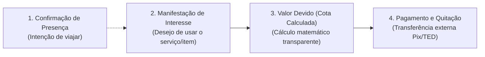

# ⚖️ Regras de Negócio — Rota de Verão

> Este documento detalha a lógica de funcionamento do sistema, as restrições operacionais e as fórmulas de cálculo para casais, confirmações de presença, divisão de despesas e votações.

---

## 1. Gestão de Participantes e Agrupamento por Casais

Uma das características centrais do **Rota de Verão** é a acomodação da dinâmica social de viagens em grupo, em que muitos participantes viajam em casal.

### 1.1. Estados Individuais de Presença
Cada participante possui, de forma autônoma, um dos 3 estados possíveis:
- **`pending` (Pendente)**: Convidado adicionado à viagem, mas ainda não se manifestou.
- **`confirmed` (Confirmada)**: Convidado confirmou expressamente sua intenção de viajar.
- **`declined` (Recusada)**: Convidado informou que não poderá comparecer.

### 1.2. Estados Agregados do Casal
Quando duas pessoas formam um casal cadastrado (`couples`), o sistema deriva em tempo real o status do grupo para fins visuais e de planejamento:

| Participante A | Participante B | Status Consolidado do Casal | Cor / Badge Indicativo |
| :---: | :---: | :---: | :---: |
| `confirmed` | `confirmed` | **Casal Confirmado** | Verde Oceano / Sucesso |
| `confirmed` | `pending` | **Casal Parcialmente Confirmado** | Âmbar / Alerta Suave |
| `pending` | `confirmed` | **Casal Parcialmente Confirmado** | Âmbar / Alerta Suave |
| `pending` | `pending` | **Casal Pendente** | Cinza Areia / Aguardando |
| `declined` | `declined` | **Casal Recusado** | Coral Suave / Cancelado |
| `confirmed` | `declined` | **Indivíduo Isolado (1 Confirmado, 1 Recusado)** | Indicador especial |

### 1.3. Princípio da Individualidade Absoluta (MVP)
> [!IMPORTANT]
> A ação de um membro do casal **nunca** altera automaticamente o status do outro. No MVP, cada pessoa deve acessar seu próprio link/PIN e responder individualmente. A interface apresenta o resumo conjunto para facilitar a visualização da organizadora e dos amigos, mas sem acoplamento de ações.
> 
> *Evolução futura planejada*: Caso a administradora habilite expressamente a opção *"Permitir que o parceiro confirme pelo casal"*, o sistema exigirá consentimento prévio do parceiro.

---

## 2. Divisão de Despesas e Controle Financeiro

O sistema financeiro foi projetado para evitar atritos e mal-entendidos entre amigos. A premissa central é a **transparência total e a separação estrita de conceitos**.

### 2.1. Os 4 Estados Financeiros Independentes
1. **Confirmação de Presença**: Indica apenas se a pessoa vai viajar. **Nunca transforma ninguém em devedor de forma automática**.
2. **Interesse em Despesa**: Participação formal em um grupo de rateio específico (ex: "Entrarei no aluguel do Carro 01").
3. **Valor Devido (Cota Calculada)**: O montante financeiro exato atribuído àquela pessoa segundo a regra matemática da despesa.
4. **Pagamento Realizado**: O status de quitação (Pendente, Pago pelo participante, Verificado pela administradora). **Nenhuma transação bancária é executada no sistema no MVP**.

### 2.2. Critérios de Divisão Suportados

#### A. Despesa Individual (`individual`)
- **Aplicação**: Passagens aéreas emitidas individualmente ou gastos particulares.
- **Fórmula**: 
  $$\text{Cota} = \text{Valor Total da Despesa}$$
- **Público**: Atribuído a um único participante.

#### B. Divisão Igualitária entre Confirmados Elegíveis (`equal_all_confirmed`)
- **Aplicação**: Hospedagem coletiva (casa de praia compartilhada), taxa de limpeza, compras comuns de supermercado.
- **Regra Restritiva**: Participantes em estado `pending` ou `declined` são **obrigatoriamente excluídos** do cálculo.
- **Fórmula**:
  $$\text{Cota Individual} = \frac{\text{Valor Total}}{\text{Total de Confirmados Elegíveis Selecionados}}$$
- *Tratamento de dízimas*: Eventuais centavos de arredondamento (ex: R$ 100 / 3 = 33,33) são ajustados na última cota ou absorvidos conforme definido pela administradora.

#### C. Divisão Exclusiva por Veículo (`vehicle_users`)
- **Aplicação**: Aluguel de carros, combustível e pedágios.
- **Regra Rígida**: O custo de um veículo é rateado **estritamente entre os ocupantes cadastrados que declararam interesse naquele veículo**.
- **Proibição**: O sistema jamais distribuirá o aluguel de um carro de 5 lugares para os 15 integrantes da viagem inteira.
- **Fórmula**:
  $$\text{Cota do Veículo} = \frac{\text{Diárias} \times \text{Valor Diária}}{\text{Total de Participantes Alocados ao Veículo}}$$

#### D. Divisão Personalizada (`equal_custom`)
- A Administradora seleciona manualmente a lista exata de pessoas que participam daquele rateio (ex: passeio de lancha que apenas 6 dos 12 confirmados quiseram fazer).

---

## 3. Votações Democráticas e Prazos

Para evitar discussões intermináveis em chats de WhatsApp:

1. **Voto Único**: Cada participante autenticado tem direito a exatamente 1 voto por enquete (`UNIQUE(poll_id, trip_member_id)`).
2. **Flexibilidade de Voto**:
   - Se `allows_change_vote = true`: O participante pode mudar de ideia e alterar seu voto até o encerramento do prazo.
   - Se `allows_change_vote = false`: O voto registrado é definitivo e não pode ser editado.
3. **Encerramento Automático**:
   - Ao atingir a data/hora de `deadline`, a enquete é bloqueada automaticamente para novos votos.
   - A Administradora pode encerrar a votação manualmente a qualquer momento antes do prazo.
4. **Visibilidade de Resultados**: Os resultados parciais (porcentagem e contagem de votos) são visíveis para todos os membros confirmados, fomentando o engajamento.

---

## 4. Monitoramento de Preços e Limitações Técnicas

### 4.1. Filosofia de Conformidade e Ética
- **Nenhum Web Scraping Ilegal**: Não realizaremos scraping que viole os Termos de Serviço da GOL, LATAM, Azul ou Localiza.
- **Sem Burlas de Proteção**: Não usaremos soluções anti-bot ou simulação forçada de requisições.
- **Transparência**: Se não houver API oficial pública e gratuita, a aplicação operará no modelo de **Alerta de Preço-Alvo Assistido**:
  1. A administradora define o teto desejado (ex: R$ 900,00).
  2. Qualquer participante ou a organizadora pode colar o link da promoção encontrada.
  3. O sistema calcula a economia e envia alerta interno para os amigos aproveitarem a tarifa antes que ela aumente.

