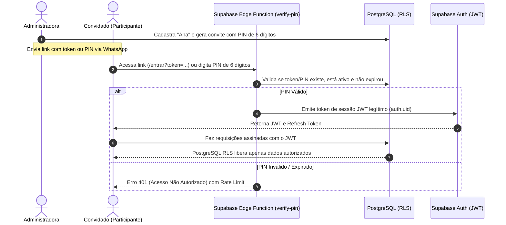

# 🛡️ Diretrizes de Segurança e Permissões — Rota de Verão

> Este documento define os mecanismos de proteção, fluxo de autenticação simplificado por PIN, políticas de Row Level Security (RLS) no PostgreSQL e a gestão segura de credenciais.

---

## 1. Arquitetura de Autenticação Segura com PIN

### 1.1. O Desafio
O projeto exige acesso simples e sem atrito para convidados (sem CPF, sem senhas complexas, sem confirmação burocrática de e-mail), mas **proíbe terminantemente autenticação falsa** (como salvar um nome no `localStorage` sem validação de servidor).

### 1.2. A Solução Técnica Adotada
Implementamos um fluxo baseado em **Supabase Auth + Edge Function de Troca Segura (Token Exchange)**:



### 1.3. Por que essa solução é 100% segura e amigável?
1. **Zero Atrito**: O convidado clica no link do WhatsApp e já entra autenticado instantaneamente.
2. **Sessão Real (JWT)**: O navegador recebe um token criptográfico padrão da indústria.
3. **Compatível com RLS**: Todas as chamadas para a API REST do Supabase carregam o cabeçalho `Authorization: Bearer <JWT>`, permitindo que o PostgreSQL use `auth.uid()` para auditar quem fez cada ação.
4. **Proteção contra Força Bruta**: A Edge Function aplica limite de tentativas (ex: no máximo 5 erros a cada 15 minutos por endereço IP).

---

## 2. Matriz de Permissões (RBAC: Role-Based Access Control)

| Recurso / Funcionalidade | Administradora | Participante Confirmado | Participante Pendente |
| :--- | :---: | :---: | :---: |
| **Editar Destino e Datas da Viagem** | ✅ Total | ❌ Bloqueado | ❌ Bloqueado |
| **Criar e Revogar Convites** | ✅ Total | ❌ Bloqueado | ❌ Bloqueado |
| **Cadastrar Voos, Casas e Carros** | ✅ Total | ❌ Bloqueado | ❌ Bloqueado |
| **Criar Enquetes e Votações** | ✅ Total | ❌ Bloqueado | ❌ Bloqueado |
| **Lançar Despesas e Definir Rateio** | ✅ Total | ❌ Bloqueado | ❌ Bloqueado |
| **Consultar Histórico de Auditoria** | ✅ Total | ❌ Bloqueado | ❌ Bloqueado |
| **Visualizar Informações da Viagem** | ✅ Total | ✅ Total | ✅ Leitura Básica |
| **Confirmar / Recusar Presença** | ✅ Própria | ✅ Própria | ✅ Própria |
| **Votar em Enquetes Abertas** | ✅ Próprio | ✅ Próprio | ❌ Exige confirmação |
| **Marcar Interesse em Veículo** | ✅ Próprio | ✅ Próprio | ❌ Exige confirmação |
| **Consultar Extrato Individual de Despesas**| ✅ Visão Geral | ✅ Próprio | ❌ Sem despesas |

---

## 3. Políticas de Row Level Security (RLS) no PostgreSQL

O RLS é a camada definitiva de proteção. Mesmo que alguém tente fazer requisições maliciosas diretamente à API usando Postman ou curl, o banco de dados rejeitará a operação.

### 3.1. Exemplo de Política para Confirmação de Presença (`trip_members`)

```sql
-- Habilita RLS na tabela
ALTER TABLE trip_members ENABLE ROW LEVEL SECURITY;

-- 1. Qualquer membro da viagem pode consultar a lista de participantes
CREATE POLICY "Membros da viagem podem visualizar os participantes"
ON trip_members FOR SELECT
TO authenticated
USING (
    trip_id IN (
        SELECT trip_id FROM trip_members WHERE profile_id = auth.uid()
    )
);

-- 2. Cada participante só pode atualizar a sua própria presença
CREATE POLICY "Participante só pode atualizar sua própria presença"
ON trip_members FOR UPDATE
TO authenticated
USING (profile_id = auth.uid())
WITH CHECK (
    profile_id = auth.uid() AND
    -- Não pode alterar seu próprio papel para 'admin'
    role = (SELECT role FROM trip_members WHERE profile_id = auth.uid())
);

-- 3. Apenas a Administradora pode adicionar ou remover participantes
CREATE POLICY "Apenas admin pode inserir ou remover participantes"
ON trip_members FOR ALL
TO authenticated
USING (
    EXISTS (
        SELECT 1 FROM trip_members
        WHERE trip_id = trip_members.trip_id
        AND profile_id = auth.uid()
        AND role = 'admin'
    )
);
```

### 3.2. Exemplo de Política para Votações (`poll_votes`)

```sql
ALTER TABLE poll_votes ENABLE ROW LEVEL SECURITY;

-- O participante só pode registrar seu próprio voto
CREATE POLICY "Participante só pode votar em seu próprio nome"
ON poll_votes FOR INSERT
TO authenticated
WITH CHECK (
    trip_member_id IN (
        SELECT id FROM trip_members WHERE profile_id = auth.uid()
    )
);

-- Apenas pode atualizar se a enquete estiver aberta e permitir alteração
CREATE POLICY "Participante só pode alterar seu voto se permitido"
ON poll_votes FOR UPDATE
TO authenticated
USING (
    trip_member_id IN (
        SELECT id FROM trip_members WHERE profile_id = auth.uid()
    ) AND
    EXISTS (
        SELECT 1 FROM polls
        WHERE polls.id = poll_votes.poll_id
        AND polls.is_closed = false
        AND polls.allows_change_vote = true
        AND (polls.deadline IS NULL OR polls.deadline > now())
    )
);
```

### 3.3. Exemplo de Política para Despesas (`cost_items` e `cost_participants`)

```sql
ALTER TABLE cost_items ENABLE ROW LEVEL SECURITY;
ALTER TABLE cost_participants ENABLE ROW LEVEL SECURITY;

-- Apenas a administradora pode criar, alterar ou excluir despesas
CREATE POLICY "Apenas administradora gerencia despesas"
ON cost_items FOR ALL
TO authenticated
USING (
    EXISTS (
        SELECT 1 FROM trip_members
        WHERE trip_members.trip_id = cost_items.trip_id
        AND trip_members.profile_id = auth.uid()
        AND trip_members.role = 'admin'
    )
);

-- Participantes só podem ler as despesas em que estão envolvidos ou da sua viagem
CREATE POLICY "Participante visualiza despesas da viagem"
ON cost_items FOR SELECT
TO authenticated
USING (
    trip_id IN (
        SELECT trip_id FROM trip_members WHERE profile_id = auth.uid()
    )
);
```

---

## 4. Gestão de Segredos e Variáveis de Ambiente

### 4.1. Regra de Ouro das Chaves do Supabase
- **`VITE_SUPABASE_URL`**: Pública. Utilizada pelo frontend para localizar o projeto na nuvem.
- **`VITE_SUPABASE_ANON_KEY`**: Pública (com RLS). Usada no frontend para assinar requisições com o cabeçalho anon. O RLS garante que nenhuma linha protegida seja acessada indevidamente.
- **`SUPABASE_SERVICE_ROLE_KEY`**: **SEGREDO CRÍTICO**. Essa chave ignora todas as regras de RLS (tem poder de superusuário). **JAMAIS deve ser incluída no código do React, no repositório Git ou em variáveis prefixadas com `VITE_`**. Ela fica restrita exclusivamente ao ambiente seguro das Edge Functions no painel do Supabase.

### 4.2. Prevenção de Vazamento
- O arquivo `.gitignore` do repositório já inclui explicitamente:
  ```
  .env
  .env.local
  .env.*.local
  ```
- Um arquivo `.env.example` sem valores reais serve de modelo seguro para novas instalações.

